# Workbench

A hardware design workbench. AI agents design the 3D parts, the circuit board and the firmware of one product, together, and check each other's work.

**[redline.medipol.dev](https://redline.medipol.dev)** · in private beta

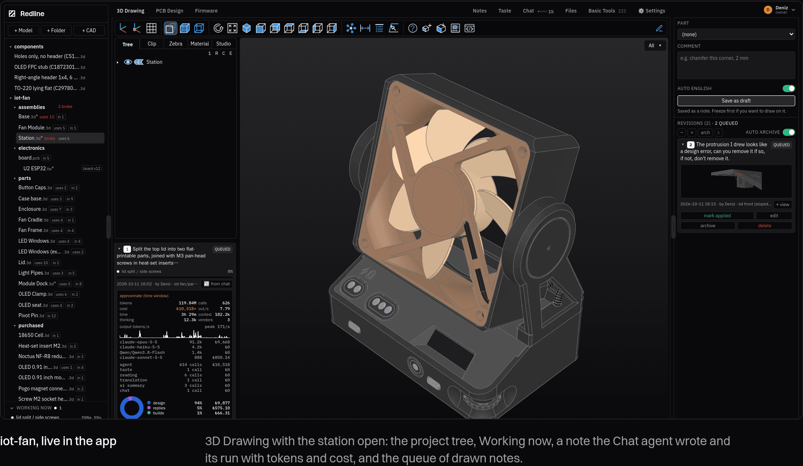

## The project, in numbers

Straight from Workbench's own analytics for iot-fan.

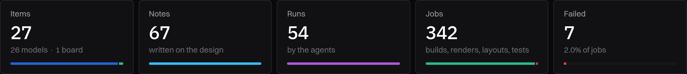

## 01 · Three rooms, one product

Parts, board and firmware are built against each other. Change the board, and the case and the pin map follow.

- **3D parts.** Three assemblies built from 26 models. Change one part, and everything that uses it is rebuilt.
- **Circuit board.** Real parts from LCSC, placed and routed by TraceMaker: 235 of 235 connections in 121 seconds.
- **Firmware.** Written for the board it runs on. Every pin is named from the schematic, and pins.h is rewritten when the board changes.

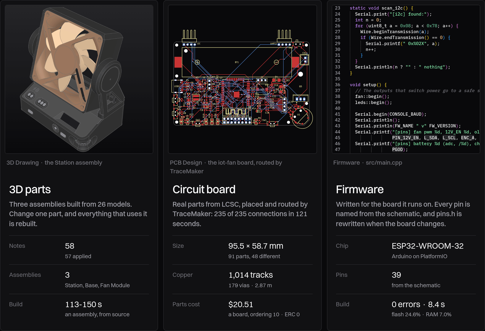

## 02 · Draw it, or write it

Mark the model or the board and say what you want. The note keeps the drawing and goes to that room's agent.

- **Draw on the model.** Hold the view, circle what is wrong and say it in a line. The picture and the camera go with the note to the 3D agent.
- **Draw on the board.** The same pen over the layout: circle the part, point where it should go, and say it in your own language.
- **A note becomes a task.** Auto English turns it into English for the agent. Saved as a draft, then queued; the note keeps its drawing and its status.

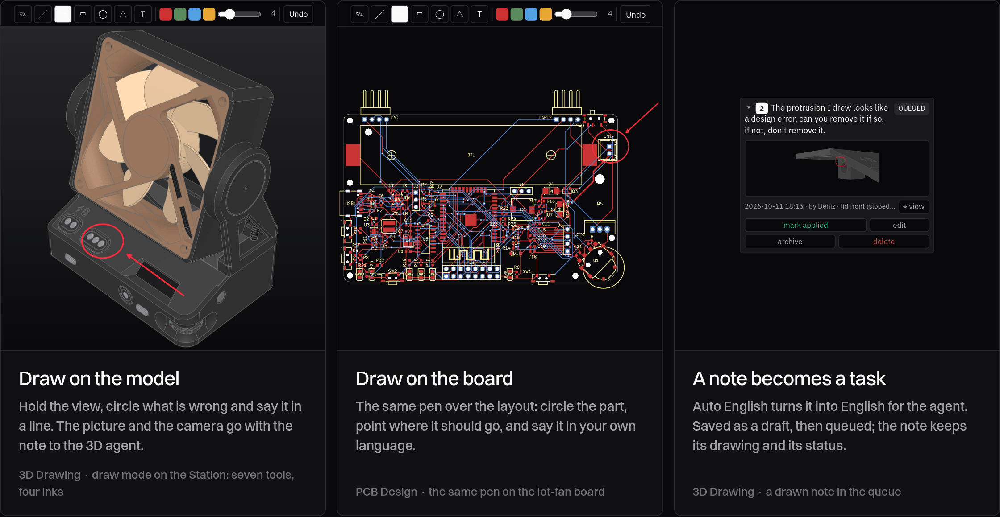

## 03 · Notes, chat and agents

Ask in Chat. It looks things up with its tools, reads your photos, and writes tasks that go to a room's agent.

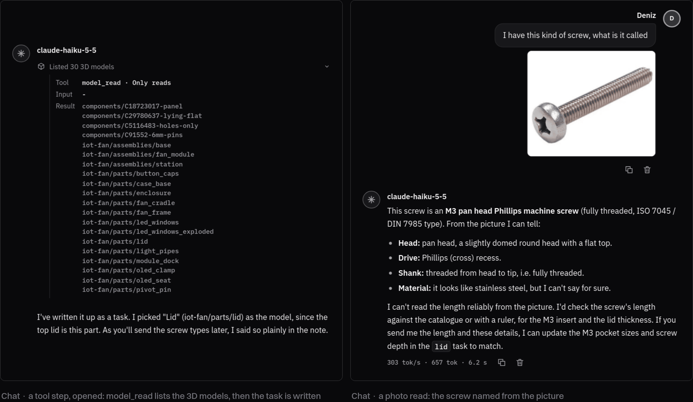

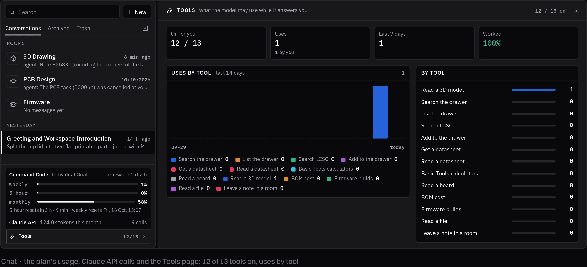

### It asks before it guesses.

**On your phone too.** The agents' questions reach Telegram; answer with a button, or send a note with a photo.

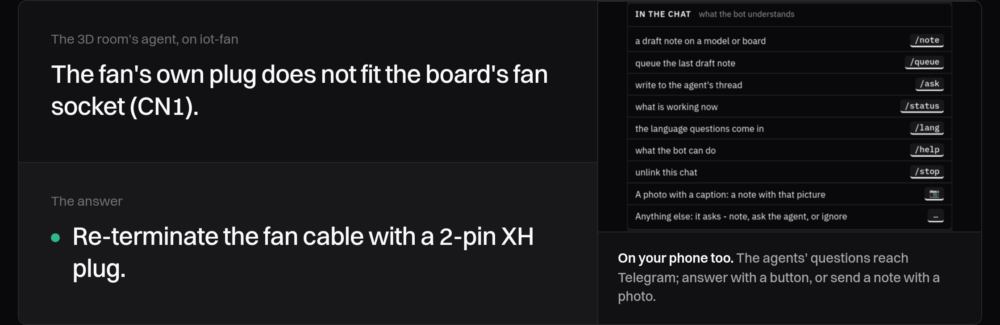

## 04 · Analytics

Every call, job and kilowatt-hour since the first note, 21 September to 11 October.

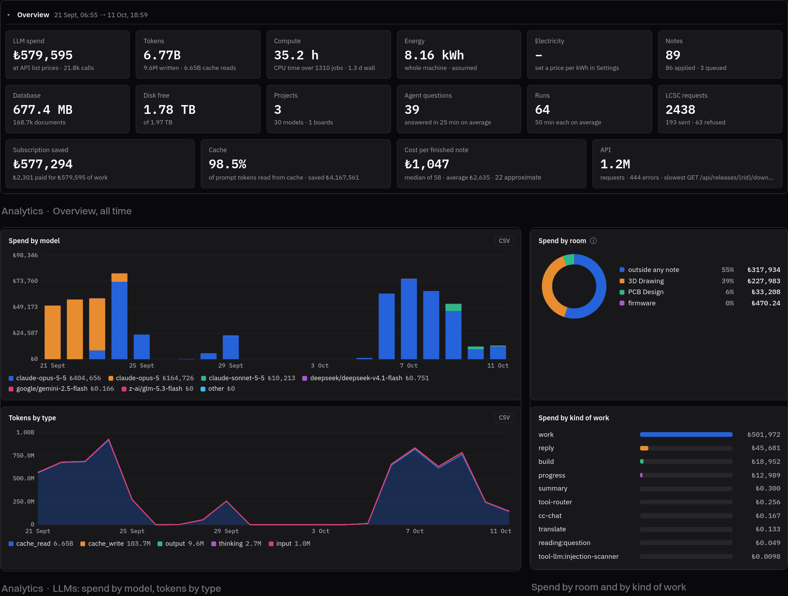

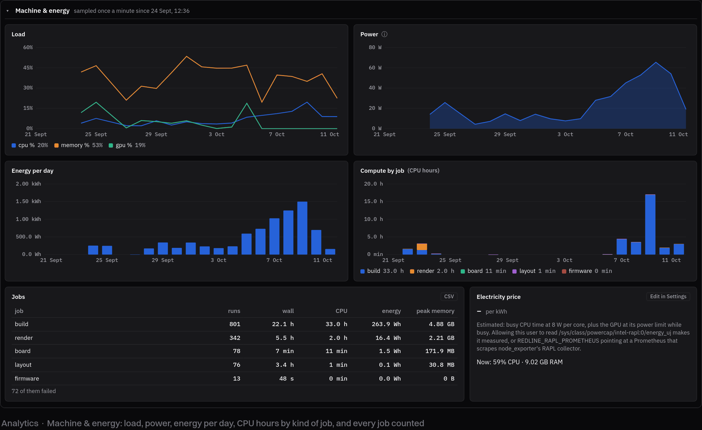

## 05 · Taste

A finished project, distilled into the rules the next one follows. One run read every model, board and firmware in iot-fan.

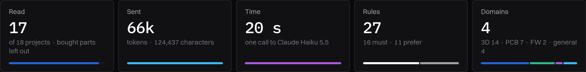

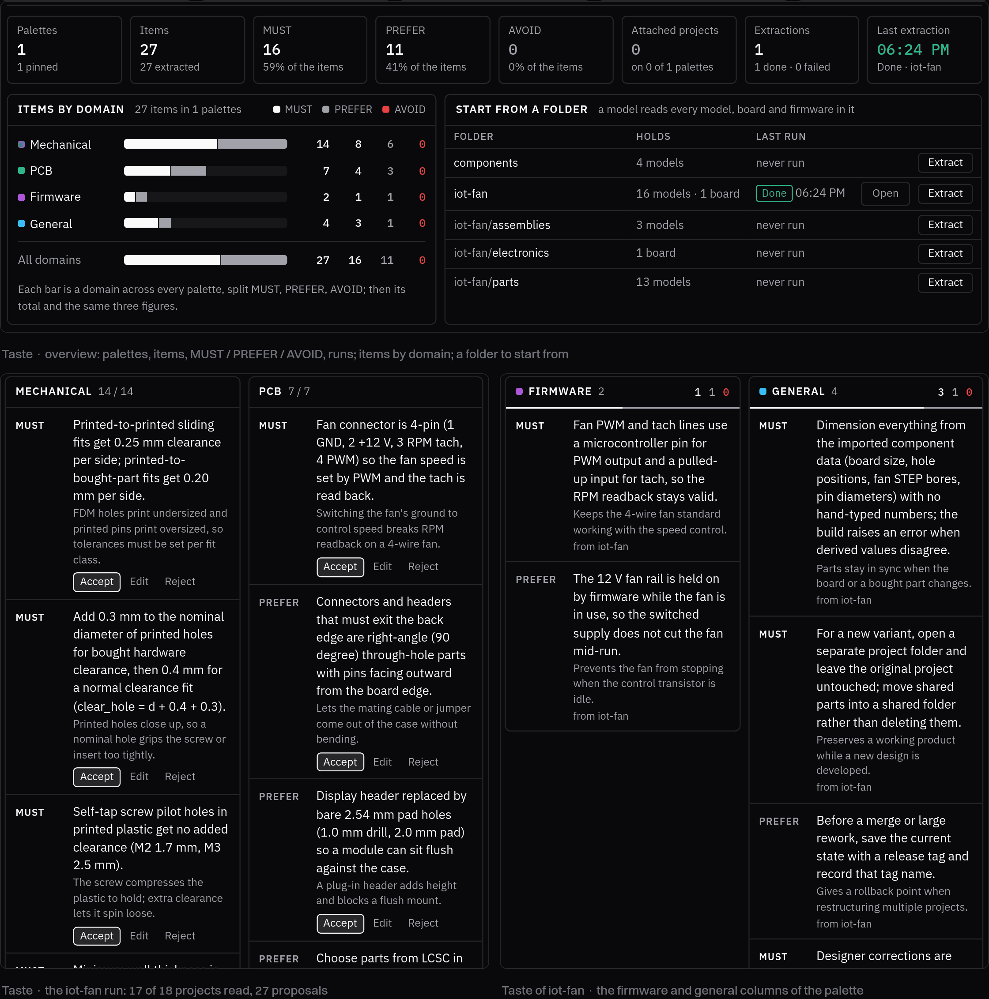

Every rule was reviewed before it was kept; attach the palette to a project and its agents follow it.

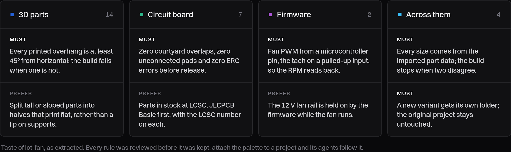

## 06 · Themes

28 themes, 22 dark and 6 light, chosen per browser. The 3D backdrop and the code editor follow.

- **And your own.** Make a theme from any of them and share it as a file; a teammate imports it.
- **Every view follows the theme.** The whole window takes the theme: panels, lines, text and the accent.

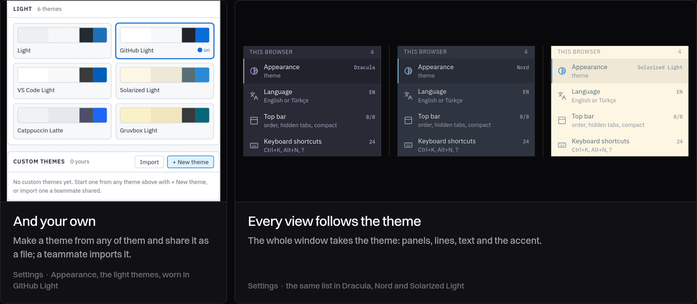

## 07 · What it cost

Connect the plans you already pay for. Workbench routes the agents' work through them and prices every call at API rates, so you see what the plans saved.

The plans against API prices: **251.9×**. ₺579,595 of work, paid with ₺2,301 of plans. Three weeks of work, 21 September to 11 October. Claude Max (₺3,170 a month) and Command Code ($5 a month), prorated over 0.67 months.

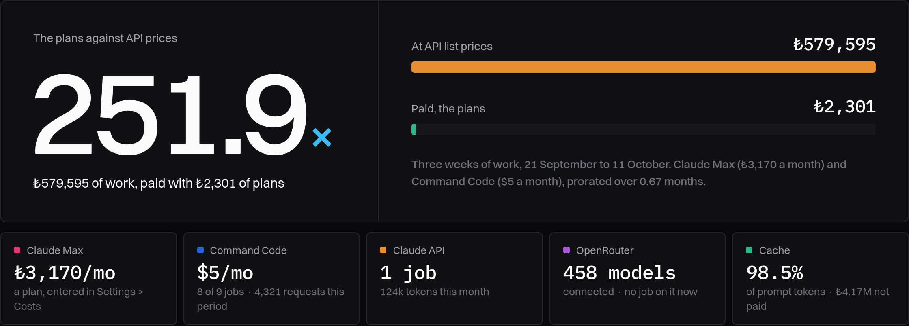

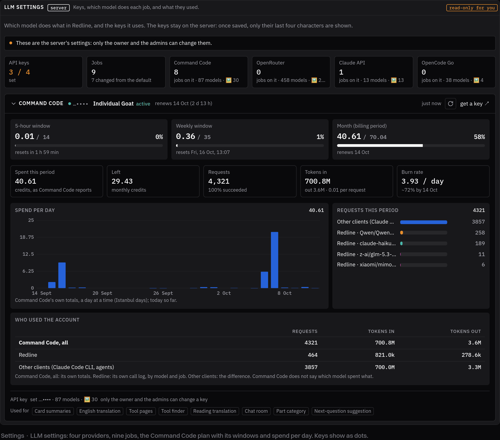

## 08 · A proxy for part lookups

EasyEDA turns bursts of lookups away. A rotating proxy gives them another way out, with its traffic and cost measured.

- **Its state.** Whether it is on, what went through it this week and what that cost, and whether EasyEDA answers.
- **Always, or when refused.** Every lookup through it, or only the ones EasyEDA turns away. Each lookup comes out somewhere new.
- **Where it came out.** How many addresses and countries, and how often and how fast a lookup worked, with and without it.

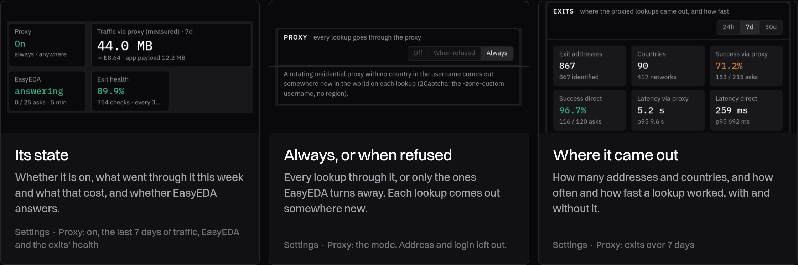

## 09 · Why not build it yourself

An agent can write a part. What it needs around it to do a whole product is the rest of this.

| | | |
|---|---|---|
| **Compute** | 1,310 jobs · 35.2 h of CPU · 8.16 kWh | 801 model builds, 342 renders; 78 board runs, 76 layouts, 13 firmware builds; queued, run in containers, timed and metered |
| **Storage** | 677 MB database · 168k documents | 250 built models, 344 MB; 229 source versions, 370 history entries; 195 note pictures, 50 files, 2 releases |
| **Agent API and MCP** | 26 tools over MCP, for any agent | agents connect from their own tools with `REDLINE_TRANSPORT=api` and a token you can revoke; each token sees one workspace; deletes are audited; 221 engineering calculators through `find_tool` and `run_tool` |
| **LLM routing and cost** | 21.8k calls, each priced and counted | 4 providers: Claude API, Command Code, OpenRouter, OpenCode Go; 9 kinds of job, each with its own model; plans you connect, priced against API rates; budgets and spend per note |

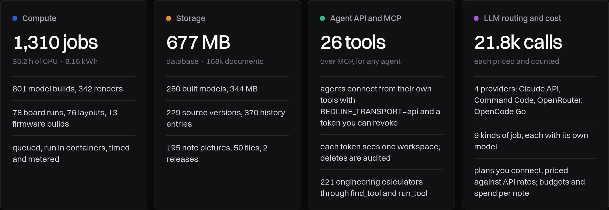

## Running it

Workbench is in private beta at [redline.medipol.dev](https://redline.medipol.dev). To run it yourself you need Python 3.10 or newer, Node 20.19 or newer, and a MongoDB connection (Atlas or a local server).

```bash
git clone https://github.com/x3beche/redline-studio.git
cd redline-studio
cp .env.example .env          # fill in MONGODB_URI
./start.sh
```

On first run `start.sh` creates the virtual environment, installs the npm dependencies and starts both servers with live reload: the UI on <http://127.0.0.1:4200>, the API on <http://127.0.0.1:8000>. `./start.sh --build` compiles the UI and serves it from `:8000` alone. `compose.dev.yml` runs the same two servers in containers, with the checkout mounted.

The model API keys are not read from `.env`: they are kept in the database and typed in Settings > LLM settings, where each job also picks its provider and model. The board room (atopile, and KiCad with Freerouting in a container), the firmware room (PlatformIO in a container), technical drawings and the Tools tab's checks each need an image built once; without them the rest still works and says what is missing.

To run an agent on your own computer against a Workbench server, use [redline-agent-seed](https://github.com/x3beche/redline-agent-seed) with a token from Agent tokens (the user menu): a start script and a few instructions, which fetch the agents' tools from the server on every start.

- [INSTALL.md](INSTALL.md): requirements, Windows (WSL 2), containers, configuration, the images, Telegram
- [USAGE.md](USAGE.md): the rooms and the everyday loop
- [AGENTS.md](AGENTS.md): for agents working in this repository
- [TOOLS.md](TOOLS.md) · [SECURITY.md](SECURITY.md) · [docs/ACCOUNTS.md](docs/ACCOUNTS.md)
